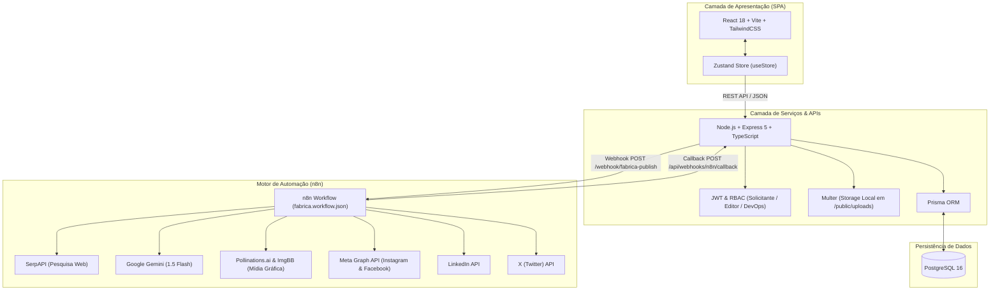

# 🏭 Fábrica de Conteúdo

> Plataforma completa de gestão de demandas de marketing, redação editorial com Inteligência Artificial e automação de publicações em redes sociais via n8n.

---

## 📌 Visão Geral

A **Fábrica de Conteúdo** é uma solução full-stack moderna concebida para acelerar e organizar a esteira de produção e distribuição de marketing digital. A plataforma oferece:

* **Gestão de Pautas e Demandas:** Solicitantes cadastram pautas com briefings, prazos e rede de destino, podendo encaminhá-las para a equipe de redatores ou para o pipeline 100% autônomo de Inteligência Artificial.
* **Esteira de Produção Editorial:** Editores assumem demandas, elaboram copies, anexam mídias e submetem os posts para revisão sem perder a visibilidade dos trabalhos em andamento.
* **Central de Aprovação Web-First:** Solicitantes aprovam publicações ou solicitam ajustes diretamente no painel web, disparando callbacks em tempo real para o orquestrador.
* **Motor de IA & Orquestração (n8n):** Workflow automatizado responsável por enriquecer pautas com pesquisa web (SerpAPI), redigir o conteúdo otimizado por rede com o **Google Gemini 1.5 Flash**, gerar arte gráfica (Pollinations.ai / ImgBB) e publicar diretamente nas redes sociais (Meta Instagram/Facebook, LinkedIn e X/Twitter).
* **Observabilidade e DevOps:** Painel com auditoria de requisições, logs de webhooks, status do ecossistema e ferramentas de reprocessamento (retry).

---

## 🏛️ Arquitetura da Solução



---

## ⚙️ Requisitos do Ambiente

* **Node.js:** Versão `18.x` ou `20.x` LTS
* **npm:** Versão `9.x` ou superior
* **Docker & Docker Compose:** Versão `20.x+` (para rodar PostgreSQL e n8n)
* **PostgreSQL:** Versão `16` (caso deseje rodar localmente fora do Docker)

---

## 🚀 Instalação e Execução Local Passo a Passo

### 1. Clonar o repositório e configurar variáveis
```bash
git clone https://github.com/seu-usuario/fabrica-conteudo.git
cd fabrica-conteudo

# Copiar arquivos de ambiente
cp .env.example .env
cp server/.env.example server/.env
```

Edite o arquivo `.env` para ajustar senhas e, se desejar, adicionar suas chaves de API (`OPENAI_API_KEY`, `IMGBB_API_KEY`, `SERPAPI_API_KEY`).

---

### 2. Subir os serviços de infraestrutura (Docker)
Inicie o banco de dados PostgreSQL e o orquestrador n8n em segundo plano:
```bash
docker compose up -d postgres n8n
```
* PostgreSQL estará acessível na porta `5432`.
* n8n estará acessível na porta `5678` (`http://localhost:5678`).

---

### 3. Rodar migrações e seed do banco de dados
Com o PostgreSQL em execução, gere o client do Prisma, aplique as tabelas e popule os dados iniciais:
```bash
# Executa a geração do cliente e o seed
npm run prisma:generate
npm run seed
```

---

### 4. Executar servidor e cliente em modo desenvolvimento
Execute o comando único que inicia a API e o Frontend concorrentemente:
```bash
npm run dev
```

* **Frontend SPA:** [http://localhost:5173](http://localhost:5173)
* **Backend API:** [http://localhost:4000/api](http://localhost:4000/api)
* **Uploads Estáticos:** [http://localhost:4000/uploads](http://localhost:4000/uploads)

---

### 5. Importar e Ativar o Workflow no n8n
1. Acesse o n8n no navegador: `http://localhost:5678`.
2. No menu lateral, clique em **Workflows** > **Import from File**.
3. Selecione o arquivo [`n8n/fabrica.workflow.json`](n8n/fabrica.workflow.json).
4. No canto superior direito do workflow, marque o botão de alternância para **Active** (Ativo).

---

## 👥 Credenciais de Teste Padrão (Seed)

O banco é populado com três usuários de teste para demonstração de cada perfil de acesso:

| Perfil | E-mail | Senha | Atribuições |
| :--- | :--- | :--- | :--- |
| **Solicitante** | `solicitante@fabrica.com` | `123456` | Cria pautas, acompanha solicitações e aprova posts na Central de Aprovação. |
| **Editor** | `editor@fabrica.com` | `123456` | Assume demandas da fila, redige posts, sobe imagens e envia para revisão. |
| **DevOps** | `devops@fabrica.com` | `123456` | Monitora logs de webhooks, reprocessa filas de IA e gerencia integrações. |

---

## 📡 Documentação de Endpoints da API

### Autenticação (`/api/auth`)
* `POST /api/auth/login`: Autentica usuário, gerando cookies seguros e tokens JWT.
* `POST /api/auth/logout`: Invalida a sessão ativa.
* `GET /api/auth/me`: Retorna os dados do usuário autenticado.

### Demandas de Publicação (`/api/demands`)
* `GET /api/demands`: Lista todas as demandas cadastradas.
* `POST /api/demands`: Registra nova demanda de conteúdo.
* `PATCH /api/demands/:id`: Atualiza status ou atribuição de editor da demanda.

### Publicações / Posts (`/api/posts`)
* `GET /api/posts`: Lista todas as publicações.
* `POST /api/posts`: Cria novo rascunho de post associado a uma demanda.
* `PUT /api/posts/:id`: Atualiza dados completos de uma publicação.
* `PATCH /api/posts/:id/status`: Altera o status editorial (`Rascunho`, `Em revisão`, `Ajustes solicitados`, `Aprovado`, `Agendado`, `Publicado`, `Erro`).

### Upload de Mídias (`/api/media`)
* `POST /api/media/upload`: Faz upload de imagem/vídeo via `Multer` para `/public/uploads` e retorna a URL pública acessível.

### Orquestrador & Webhooks (`/api/n8n` & `/api/webhooks`)
* `GET /api/n8n/logs`: Lista os registros de auditoria e execuções do n8n.
* `POST /api/n8n/trigger`: Dispara manualmente o workflow de publicação para um post.
* `POST /api/n8n/approve`: Aprovação nativa web-first disparada pela Central de Aprovação.
* `POST /api/n8n/retry/:logId`: Reprocessa um webhook que tenha falhado.
* `POST /api/webhooks/n8n/callback`: Endpoint de retorno seguro (autenticado por `x-fabrica-secret`) chamado pelo n8n ao gerar conteúdos ou concluir publicações.

---

## 📂 Estrutura de Diretórios

```
fabrica-conteudo/
├── dist/                      # Bundle de produção do Frontend
├── n8n/                       # Orquestração do Workflow N8N
│   ├── fabrica.workflow.json  # Workflow desacoplado e 100% funcional
│   └── refactor_workflow.cjs  # Script utilitário de parametrização
├── public/                    # Assets estáticos e uploads
│   └── uploads/               # Mídias locais servidas publicamente (.gitkeep)
├── server/                    # Backend API (Node.js + Express)
│   ├── prisma/                # Schema e scripts de Seed
│   └── src/
│       ├── config/            # Variáveis de ambiente e constantes
│       ├── db/                # Camada de persistência Prisma e Repositories
│       ├── modules/           # Módulos: auth, demands, posts, media, n8n, webhooks
│       └── server.ts          # Inicialização do servidor HTTP
├── src/                       # Frontend SPA (React + TypeScript)
│   ├── components/            # Modais, formulários, sidebar e UI
│   ├── pages/                 # Telas da esteira (ApprovalCenter, Drafts, Requests, etc.)
│   ├── services/              # Cliente HTTP Axios/Fetch
│   ├── store/                 # Gerenciamento de estado global (Zustand)
│   └── utils/                 # Utilitários seguros de data e conversão
├── .env.example               # Modelo de variáveis de ambiente
├── .gitignore                 # Arquivos e pastas ignorados no repositório
├── docker-compose.yml         # Orquestração de containers (Postgres, API, N8N)
├── package.json               # Dependências e scripts da aplicação
└── README.md                  # Documentação oficial do projeto
```

---

## 🛡️ Licença

Projeto desenvolvido para fins de produção editorial e automação de marketing digital. Distribuído sob os termos da licença MIT.
